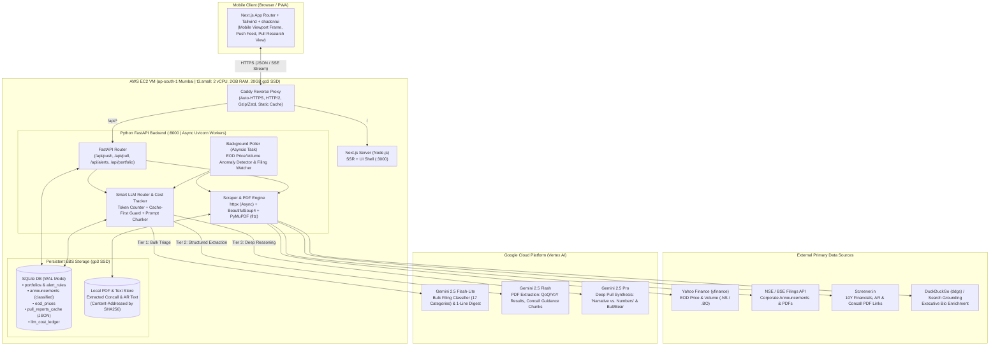
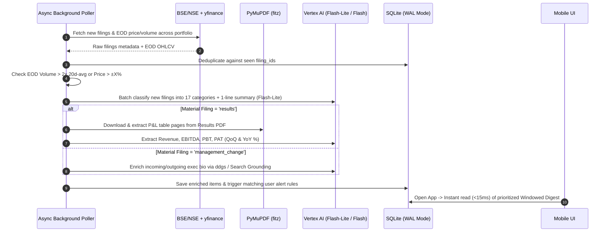
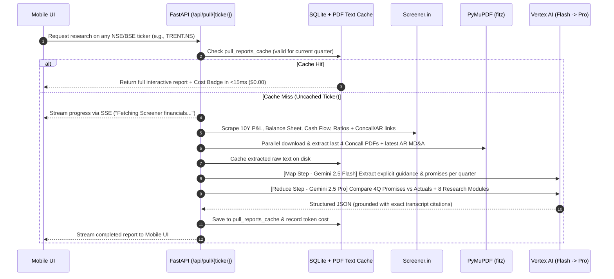

# FINN: System Architecture & Capacity Plan

## 1. End-to-End System Architecture Diagram

---

## 2. Push vs. Pull Execution Flows

### A. Push Flow (Proactive Digest & Threshold Alerts)

### B. Pull Flow (On-Demand Primary-Source Deep Research)

---

## 3. Concurrent Users & Capacity Calculation

Assuming an **AWS EC2 `t3.small`** instance in `ap-south-1` (Mumbai):
* **Hardware:** 2 vCPUs, 2 GB RAM, 20 GB gp3 NVMe SSD (3,000 IOPS, 125 MB/s), 5 Gbps burst network.
* **Database Configuration:** SQLite with `PRAGMA journal_mode=WAL;` and `PRAGMA synchronous=NORMAL;` (allows concurrent reads while a write is occurring).

### Bottleneck Analysis by Resource

#### 1. RAM Footprint (2,048 MB total)
| Component | Memory Used | Notes |
| :--- | :--- | :--- |
| Ubuntu 24.04 LTS OS + Kernel + Caddy | ~220 MB | Minimal footprint |
| Next.js Production Server (`next start`) | ~200 MB | Serves mobile shell |
| FastAPI (2 Uvicorn workers) | ~250 MB | `~125 MB` per async Python worker |
| SQLite Page Cache (`cache_size = -64000`) | ~64 MB | Keeps hot DB pages in RAM |
| Peak `PyMuPDF` + `httpx` buffer (concurrent PDF parsing) | ~350 MB | ~30–50 MB per active 200-page Annual Report parse |
| **Total Used at Peak** | **~1,084 MB** | **~960 MB free headroom** |

#### 2. Workload Latency & Throughput Math
Traffic falls into two distinct categories:
1. **Cached Reads & Push Digests (95% of traffic):**
   - Viewing the Push digest, toggling time windows (24h / 7d / 30d), filtering categories, checking triggered alerts, or opening an already-analyzed Pull company report.
   - **Latency:** SQLite WAL read + FastAPI serialization takes **3 ms – 8 ms** of CPU time per request.
   - **Throughput:** With 2 vCPUs, FastAPI + SQLite WAL comfortably serves **250 – 400 requests/second**.

2. **Uncached "Cold" Pull Research Generation (5% of traffic):**
   - When a user types a brand-new NSE ticker that isn't in `pull_reports_cache` yet.
   - **I/O bound (Network + Vertex AI):** Scraping Screener + downloading 4 Concall PDFs (`~2s` via async `httpx`) + `PyMuPDF` text extraction (`~0.4s` CPU time) + Vertex AI Flash/Pro synthesis (`~12–18s` network wait).
   - Because FastAPI uses `asyncio`, waiting on Vertex AI consumes **zero CPU**.
   - **Hard limits on Cold Pulls:**
     - **CPU (`PyMuPDF` parsing):** ~0.4s CPU per cold ticker -> max **~5 cold tickers parsed/second**.
     - **Vertex AI Quota (Default GCP Tier 1):** 300–1,000 RPM for Gemini 2.5 Flash/Pro -> **~5–15 cold ticker analyses/minute** before hitting GCP rate limits.
     - **In-flight deduplication (`asyncio.Lock` per ticker):** If 50 users request the same uncached ticker (`ZOMATO.NS`) simultaneously, only **1** scrape/LLM job runs and all 50 receive the result.

---

### Final Concurrency Numbers (`t3.small` @ $15/mo)

Taking an active investor session where a user clicks/interacts **once every 15 seconds** (1/15 req/s per active user):

| Scenario | Max Concurrent Active Users | Requests / Sec (RPS) | Limiting Factor |
| :--- | :--- | :--- | :--- |
| **1. Push Digest, Alerts & Cached Pull Reports** *(Normal daily workflow)* | **3,500 – 5,000 concurrent users** | ~250 – 350 RPS | vCPU serialization & Caddy/Uvicorn workers |
| **2. Mixed Workload** *(95% cached reads + 5% brand-new uncached tickers)* | **400 – 600 concurrent users** | ~30 – 40 RPS *(including ~10–15 cold LLM analyses/min)* | Vertex AI RPM quota & `PyMuPDF` RAM buffer |
| **3. Worst-Case Cold Stampede** *(100% of users requesting distinct uncached tickers at the exact same second)* | **15 – 25 simultaneous cold analyses** | ~15–25 concurrent PDF+LLM pipelines | 2 GB RAM (`PyMuPDF` buffers) & Vertex AI RPM quota |

> [!TIP]
> **Vertical Scaling Ceiling (Zero Code Changes):**
> Upgrading the EC2 instance type from `t3.small` ($15/mo) to `t3.medium` (4 GB RAM, $30/mo) or `c7g.large` (4 GB RAM, dedicated CPU, $50/mo) immediately doubles/triples the in-memory PDF parsing concurrency without touching a single line of code or database config.

