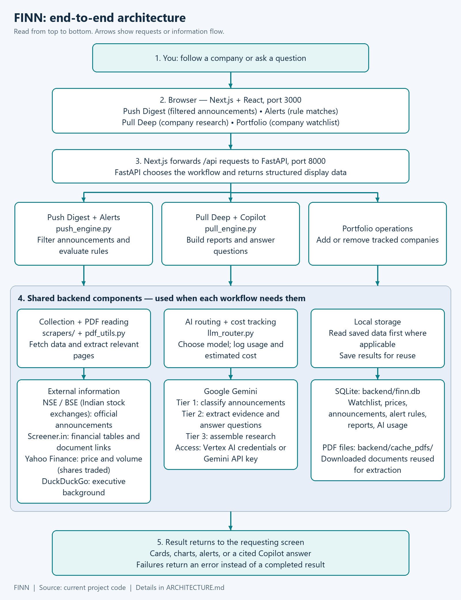
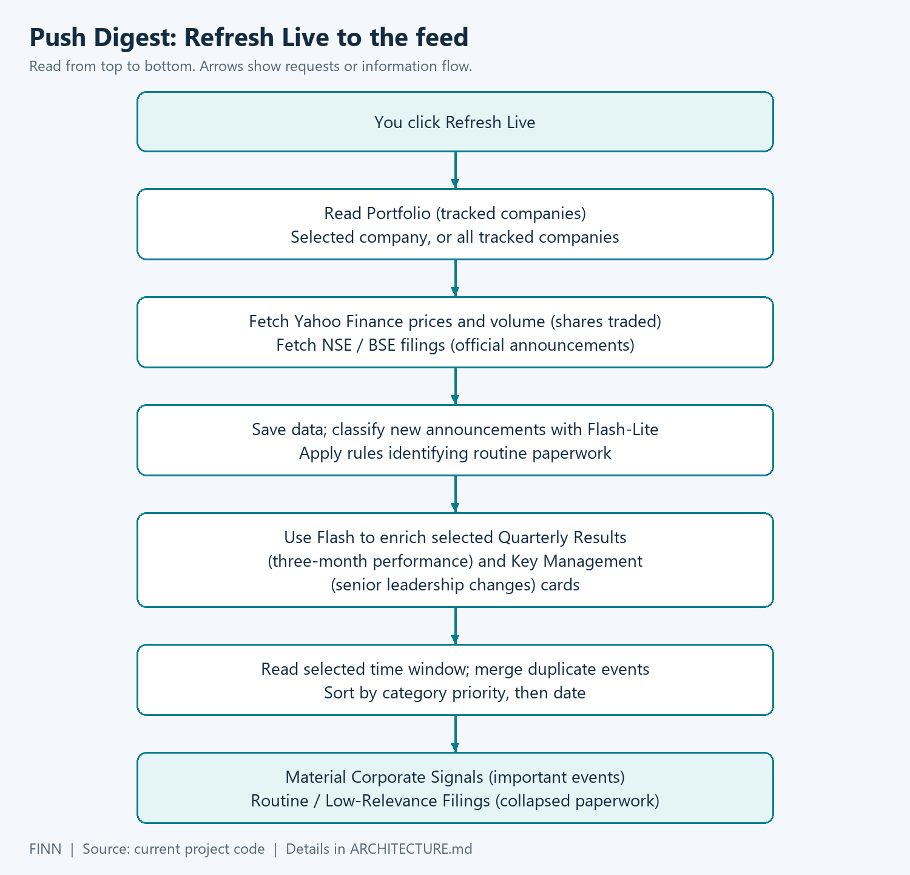
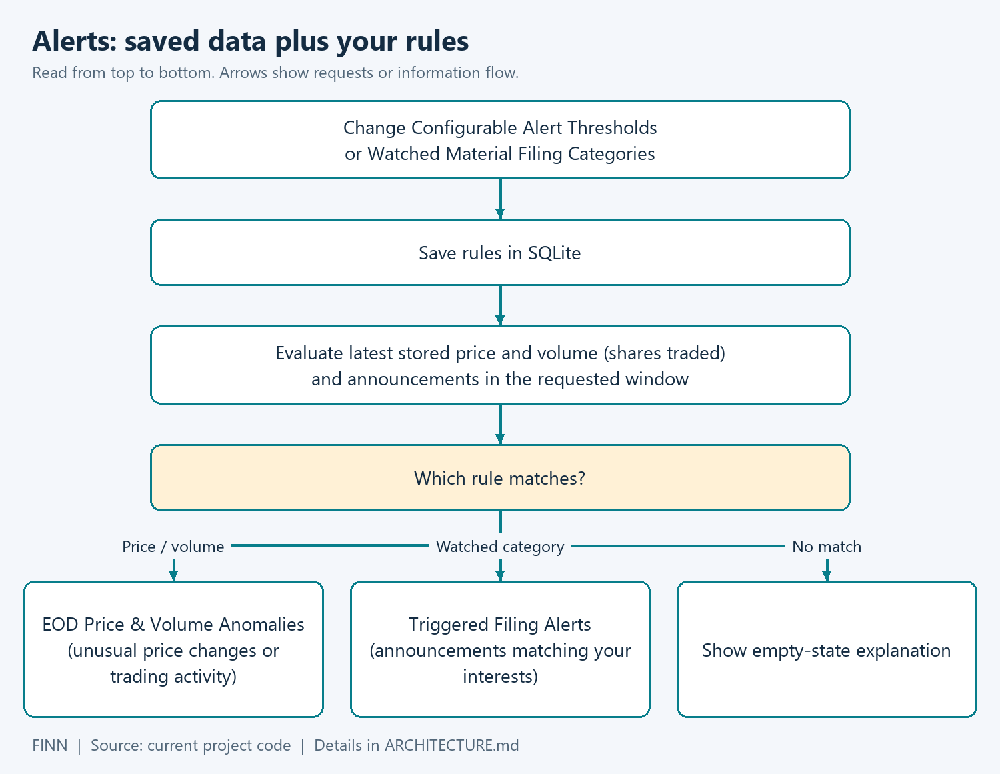
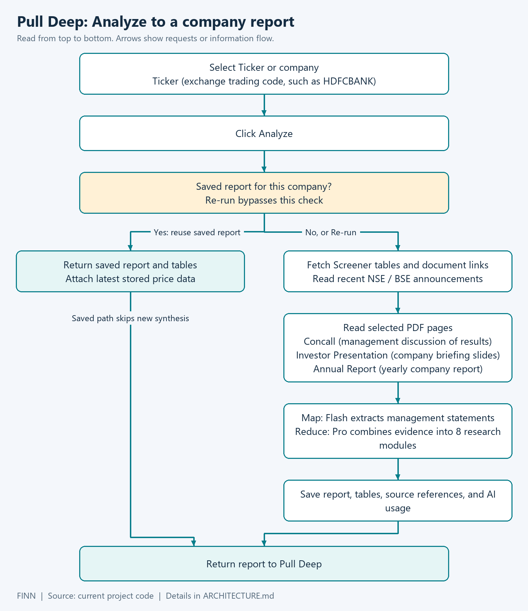
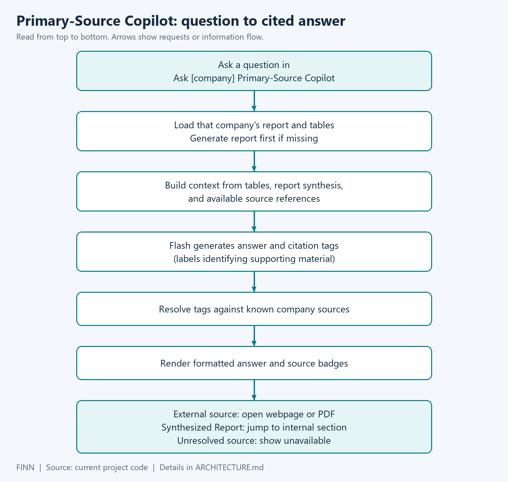

# FINN architecture

This file describes how the code works today. File references use `path:line` so you can check each claim. Cost and token numbers come from `backend/finn.db`, and the main ones are summarised in [COVERING_NOTE.md](COVERING_NOTE.md).

The diagrams are PNGs rendered from the Mermaid files next to them (`python docs/diagrams/render_diagrams.py`), so they show without a Mermaid viewer.

## 1. The whole system

[Full size](docs/diagrams/architecture-overview.png) · [Mermaid source](docs/diagrams/architecture-overview.mmd)

The browser talks to a FastAPI backend. The backend reads SQLite, scrapes NSE, Screener.in and Yahoo Finance when it needs fresh data, and calls Gemini for classification, extraction and synthesis. Results are saved so a second visit costs nothing.

| Part | What it does | Main files |
| --- | --- | --- |
| UI | Four tabs, cards, charts, loading and error states | `frontend/src/app/page.tsx`, `frontend/src/components/` |
| API | Routes, paid-call guards, optional background refresh | `backend/main.py` |
| Scrapers | NSE/BSE announcements, Screener tables and PDF links, yfinance prices | `backend/scrapers/` |
| PDF handling | Download, cache by URL hash, pick pages by keyword | `backend/pdf_utils.py` |
| Push engine | Refresh, triage, card enrichment, digest, alerts | `backend/push_engine.py` |
| Pull engine | Research report (map + reduce), staleness, Copilot | `backend/pull_engine.py` |
| LLM router | Model per tier, fallbacks, price table, cost ledger, results-card maths | `backend/llm_router.py` |
| Storage | SQLite in WAL mode, PDF cache on disk | `backend/db.py`, `backend/finn.db`, `backend/cache_pdfs/` |

There are two ways to run it:
- **Local dev:** Next.js on :3000 forwards `/api/*` to FastAPI on :8000 (`frontend/next.config.mjs`). The proxy timeout is 180 s (`next.config.mjs:19`) because a cold Pull report took 74 s on average in the warmup run (section 5).
- **One container:** `FINN_STATIC_EXPORT=1 next build` writes a static site to `frontend/out`, and FastAPI serves it on the same origin (`backend/main.py:524-526`, `Dockerfile`).

## 2. The four tabs

| Tab | Question it answers | What happens |
| --- | --- | --- |
| **Push Digest** | What happened at my companies? | Reads stored announcements for a window (24h by default; 48h, 7d, 14d, 30d). Material items first, routine ones collapsed. **Refresh Live** fetches new data. |
| **Alerts** | What crossed my rules? | Checks the latest stored prices and volumes and the watched filing categories against my thresholds. |
| **Pull Deep** | Explain this company. | **Analyze** opens a cached report or builds one. **Ask … Copilot** answers follow-up questions. |
| **Portfolio** | What am I tracking? | Add or remove tickers. Adding a ticker looks it up on Screener and fetches prices and 14 days of filings (`backend/main.py`, `api_add_portfolio_stock`). It does not build a Pull report. |

The app boots on TRENT's Pull report (`page.tsx:196`). The ad-hoc chips are DIXON, POLYCAB, INDHOTEL and PERSISTENT (`PullTab.tsx:49`). Any NSE symbol can be typed in; nothing is hard-wired to the demo set.

## 3. Push: daily triage

[Full size](docs/diagrams/push-digest.png) · [Mermaid source](docs/diagrams/push-digest.mmd)

### 3.1 What a refresh does

`refresh_portfolio_push_data` (`push_engine.py:141`):
1. Fetch end-of-day price and volume for every portfolio stock from yfinance. Only completed sessions count, so a half-day bar during market hours is dropped (`market_data.py:12`). Volume is compared with the average of up to 20 earlier sessions (`market_data.py:60`).
2. Fetch announcements from NSE's JSON API after a cookie warm-up. If NSE returns nothing or fails for a stock, try BSE (`filings.py:367`). There is no row cap; the date range bounds the request.
3. Classify each new row with regex rules first (free), then send untriaged rows to Tier 1 in batches of 15. One refresh sends at most 20 batches (300 filings); the rest wait for the next refresh (`push_engine.py:39-41`).
4. Enrich material `results` and `management_change` cards that have no card yet, up to `max_enrich` per refresh. Each card is wrapped in its own `try/except`, so one failed Gemini call shows up as `enrichment_errors` instead of a 500 (`push_engine.py:197-211`).
5. Record the refresh time and each exchange's status in `app_meta`. If every source failed, the old timestamp stays, so the UI keeps saying "Cached" (`push_engine.py:254`).

Who triggers a refresh:
- **Refresh Live** in the UI: 14 days of filings, up to 4 cards, only the selected ticker if a chip is selected (`page.tsx:261`, `api.ts:112`).
- The optional background loop: set `FINN_REFRESH_MINUTES` and the server runs a full refresh every N minutes with the function defaults, 10 days and up to 6 cards (`push_engine.py:141-145`, `main.py:192-241`). A cycle that finds the previous one still running is skipped.
- `python backend/warmup_demo.py`, which I used to fill the demo database.

### 3.2 Triage: what earns attention

- **Regex pre-classifier** (`filings.py:29`): 16 rules map titles to the ENAM categories. The first match wins and every pattern matches whole words only.
- **Hygiene guard** (`filings.py:124`): routine paperwork can never be material, whatever the regex or the model said. That covers newspaper publications, Reg 74(5) certificates, trading-window closures, ESOP allotments, analyst-meet schedules, board-meeting date notices, auditor appointments, guarantees for subsidiaries, and a bank's or NBFC's routine NCD issues.
- **Tier 1 batch triage** (`llm_router.py:288`): category, materiality 0/1 and a one-line summary of at most 18 words. The prompt says to state only facts in the title. Titles that say nothing ("Change in Director(s)") carry the first 1,500 characters of page 1 of the PDF (`llm_router.py:275-276`). If there is no PDF text either, the summary is exactly "Filing does not specify details; see attached PDF" instead of a guess.
- **Ranking** (`push_engine.py:43`): a fixed order. Results first, then M&A, management change, fund raise, litigation, capex, credit rating, and so on. Newer items come first inside a category. This is not a model score.
- **Duplicates** (`push_engine.py:325`): filings about the same event are grouped (results by ticker; management changes by ticker and person; others by ticker, category, day and title prefix). One card stays and the rest are listed under **Also filed as** (`FilingCard.tsx:317`). The noise percentage counts routine items plus folded duplicates (`push_engine.py:471`).
- **Routine drawer**: routine rows stay in the database and are shown collapsed under the material ones.

### 3.3 Quarterly results card

The brief asks for Revenue, EBITDA, PBT and PAT with QoQ and YoY. I don't let the model do any arithmetic (`enrich_quarterly_results`, `llm_router.py:752`):

1. Up to 10 keyword-ranked pages of the results PDF go to Tier 2. The model only copies raw line items for three columns (this quarter, last quarter, same quarter last year) in the unit printed on the statement.
2. Python converts the unit to ₹ Cr (`UNIT_TO_CR`, `llm_router.py:425`) and computes the four lines and every QoQ/YoY % (`_pct_change`, `llm_router.py:442`). A % off a zero or negative base shows "n/a".
3. Definitions follow Screener's quarterly table (comment block above `llm_router.py:425`). Revenue is revenue from operations; other income is never revenue. EBITDA is Screener's "Operating Profit", so it excludes other income and exceptional items. For banks and NBFCs the line is Screener's "Financing Profit", which is after provisions. That makes it different from PPOP, and the card labels it "Financing Profit" (`_operating_profit`, `llm_router.py:460`).
4. Plausibility check: revenue above zero, PAT at most 80% of revenue, and for non-lenders EBITDA at most 95% of revenue (`llm_router.py:715`).
5. Screener cross-check, only when Screener's latest column is the same quarter and basis. Every line must then agree within 1% or ₹1 Cr (`llm_router.py:435-436`). Right after a filing, Screener usually still shows the previous quarter. The PDF numbers are then kept without the cross-check and the card records `pdf_only_screener_behind`. If the PDF numbers can't be used, Screener's table stands in only when it is for the same quarter (`_screener_gate`, `llm_router.py:565`).
6. The one-line takeaway is written by Tier 2 from the computed numbers and then checked (`_takeaway_ok`, `llm_router.py:581`). It is rejected if it uses "strong", "robust", "stellar", "impressive", "healthy", "solid" or "excellent" while PAT or EBITDA fell QoQ or YoY (`llm_router.py:439`). It is also rejected if it skips an exceptional item of ₹0.5 Cr or more, or if it quotes a % that Python didn't compute. A rejected takeaway is replaced by a sentence built from the numbers (`llm_router.py:599`).

The card shows its source (filing PDF or Screener) and basis (`FilingCard.tsx:199-208`). It also stores how its numbers were checked in `verification_status`, which the UI doesn't show. For the 33 results cards in the demo database: 15 `screener_fallback`, 11 `verified_screener`, 5 `pdf_only_quarter_unknown`, 2 `pdf_only_basis_mismatch`.

### 3.4 Management change card

`enrich_management_change` (`llm_router.py:915`):
1. Tier 2 extracts the person, role, action and effective date from the first 4 PDF pages and the title. If the title names someone and the extract picked a different director, the title's facts win (`_title_person_mismatch`, `llm_router.py:907`).
2. A DuckDuckGo search (5 results, `llm_router.py:847`) looks for background on that person. The brief allows web enrichment on the Push side.
3. Tier 2 writes a bio of at most 2 sentences with facts only. If the bio contains a praise word from `_PRAISE_WORDS` ("seasoned", "visionary", "significant", "instrumental" and others), it is replaced by a plain record built from the extracted fields (`llm_router.py:995`).

### 3.5 Windows and freshness

- The window is measured back from the last successful refresh, not from "now" (`_get_reference_now`, `push_engine.py:379`). So a "24h" view after a weekend means the 24 hours before the last refresh, and the header says when that was.
- The header shows "NSE Live", plus "BSE blocked" when BSE was tried and refused. After 12 hours without a refresh it just says "Cached" (`PushTab.tsx:17-52`).

## 4. Alerts

[Full size](docs/diagrams/alerts.png) · [Mermaid source](docs/diagrams/alerts.mmd)

- **Rules** live in one `alert_rules` row: price move (default 3%), volume multiple (default 2x) and watched categories. These defaults match the brief. Sliders save 400 ms after the last change, so keyboard changes persist too (`AlertsTab.tsx:184`).
- **Evaluation** is plain Python on stored data (`get_triggered_alerts`, `push_engine.py:499`): `|1-day % change| >= threshold`, `volume / 20-session average >= multiple`, and material filings in watched categories (deduplicated like the digest). No model decides whether a threshold was crossed.
- **Polling:** the page re-reads `/api/push/alerts` every 60 s while the tab is visible, and once more when it becomes visible again (`page.tsx:35`, `page.tsx:204-215`). That endpoint only reads SQLite, so polling costs nothing. New data comes from Refresh Live or the background loop.
- **Unseen alerts:** every alert has a stable ID (`market:<ticker>:<date>:price|volume` or `filing:<id>`). Seen IDs are kept in `localStorage`. The bottom-nav bell shows an unseen count, new cards get a NEW pill, and an alert that appears between polls shows an in-app toast.
- **Browser notifications** are opt-in from the Alerts tab and use the `Notification` API (`AlertsTab.tsx:47`). They only fire while the page is open. Android Chrome only allows notifications from a service worker, so there you get the toast only (`AlertsTab.tsx:53`).

## 5. Pull: on-demand research

[Full size](docs/diagrams/pull-deep.png) · [Mermaid source](docs/diagrams/pull-deep.mmd)

`get_or_generate_pull_report` (`pull_engine.py:352`):

1. **Cache check.** One cached report per ticker in `pull_reports_cache`. A cached read makes no LLM call.
2. **Screener scrape.** Quarterly table, 10-year P&L, balance sheet, cash flow, ratios, and links to concall transcripts, presentations and annual reports. Consolidated first, standalone if consolidated is empty.
3. **Primary documents, in parallel** (`pull_engine.py:77-124`): the latest 4 concalls on Screener (transcript, or the presentation when there is no transcript) and the latest Annual Report. Up to 8 recent material filings are added from the database.
4. **Map (Tier 2).** One call extracts management's stated guidance, segment and demand commentary, and a few quotes from each document. From the Annual Report it also pulls MD&A, segment numbers, contingent liabilities, related-party transactions and the auditor's opinion.
5. **Reduce (Tier 3).** One call writes the 8 modules from the Screener tables and the map notes: business snapshot, financial snapshot, trajectory, balance sheet, cash quality, narrative vs numbers (4-quarter audit), guidance, and bull vs bear.
6. Python checks units and the "No guidance" rule (5.2), attaches the source list, and saves the report together with its own token and cost totals.

In the 2026-10-31 warmup run, reports ran one after another and the gap between consecutive reports averaged 74 s (62-92 s, n=20 gaps). Each gap covers the scrape, the PDF work, the map and the reduce.

### 5.1 Page selection instead of whole PDFs

`extract_pdf_text` (`pdf_utils.py:98`) never sends a whole long PDF:
- If a PDF has no more pages than the cap, all of them are read. Otherwise the first 3 pages are always kept (cover and summary, `pdf_utils.py:134`). Every other page scores one point per distinct keyword it contains (`pdf_utils.py:142`). The best-scoring pages fill the remaining slots and are put back in page order. Each page carries a `--- [Page N of M] ---` marker so the model can cite it.
- **Annual Report:** at most 13 pages, 3,000 characters per page and 40,000 characters in total (`pull_engine.py:64-66`). The keywords target MD&A, segment results, contingent liabilities, related parties and the auditor's report (`pull_engine.py:42`).
- **Concall transcript or presentation:** at most 10 pages and 16,000 characters, then cut to 12,000 characters for the map prompt (`pull_engine.py:91`, `pull_engine.py:67`).
- **Results filing (Push):** at most 10 pages and 35,000 characters, with results keywords (`pdf_utils.py:18`, `pdf_utils.py:176-178`).
- Downloaded PDFs are cached as `backend/cache_pdfs/<sha256(url)>.pdf` (`pdf_utils.py:34`), so a re-run doesn't download them again.

What this selection does on the 21 cached reports. I re-ran it offline on the cached PDFs, with no LLM involved:

| Document | n | Avg pages in PDF (min-max) | Avg pages sent | Avg characters in PDF | Avg characters sent | Share of characters sent |
| --- | --- | --- | --- | --- | --- | --- |
| Annual Report | 21 | 438 (187-756) | 12.7 | 1,387,754 | 33,161 | 2.4% |
| Concall / presentation | 79 | 27.5 (10-90) | 6.5 | 52,838 | 11,549 | 21.9% |

These are characters, not tokens. I didn't count tokens for whole PDFs because I never sent one.

The selection has a known gap. It is one keyword-scored pass over the whole Annual Report, so a section whose pages don't use those phrases can be missed (`ponytail:` note at `pull_engine.py:62`).

### 5.2 Guards against made-up numbers

| Risk | What the code does | Where |
| --- | --- | --- |
| Model does arithmetic on a results card | Model copies line items only. Python converts units and computes EBITDA/Financing Profit, PBT, PAT and every QoQ/YoY % | `llm_router.py:514`, `llm_router.py:442` |
| Takeaway says "strong" for a falling quarter, or skips a one-off | `_takeaway_ok` rejects it and a sentence built from the numbers is used instead | `llm_router.py:581` |
| Old guidance carried into a quarter with no call | For each of the last 4 quarters, Python checks whether a concall or presentation is dated inside that quarter's three months, which means it was held before the quarter ended. If none, the prompt says so, and after the reduce Python overwrites that row's narrative and verdict with "No guidance" | `pull_engine.py:192`, `pull_engine.py:602`, `pull_engine.py:621-623` |
| Annual Report amounts in lakhs or millions read as crores | Python appends the ₹ Cr value after every lakh/million/thousand amount in the map notes. After the reduce, a "₹X Cr" whose X equals a raw lakh/million amount is swapped for the converted value. A figure 50x or more above Screener's total assets is marked "(unit unverified)" | `pull_engine.py:289-349` |
| Copilot cites a document it never read | The prompt lists only the documents whose notes are in its context and says to answer "not in the loaded filings" when the answer isn't there. Python then drops any document citation that isn't one of those | `pull_engine.py:1047-1048`, `pull_engine.py:1077-1083` |
| Copilot invents a link | Citation labels are resolved against known Screener sections, cached document URLs and report sections. Anything else is shown as unavailable | `resolve_copilot_citations`, `pull_engine.py:697` |

HAL is the worked example for "No guidance". Since 2023, Screener lists one HAL call a year, in May. In the cached report, Sep 2025, Dec 2025 and Mar 2026 say "No guidance", and Jun 2026 is audited against the May 2026 call.

What is **not** computed in Python: in the Pull report, the QoQ/YoY figures in the 4-quarter audit, the 3-year CFO/PAT conversion in cash quality, the debt-to-equity ratio and the chart series are written by the reduce model from the Screener tables in its prompt. The prompt asks for them, but nothing recomputes them afterwards. Moving those into Python, as the results card already does, is the next fix I'd make (see the covering note).

### 5.3 Banks and NBFCs

The reduce prompt has extra rules for lenders: use Financing Margin, don't treat deposits and borrowings as distress, and judge them on capital adequacy, asset quality and ROE. The lender check used by Push is name-based (`_LENDER_NAME`, `filings.py:102`). It misses lenders without "bank", "finance" and similar words in their name (`ponytail:` note at `filings.py:99`). Results cards use Screener's "Financing Profit" row when Screener is reachable.

### 5.4 When a cached report is out of date

`_report_staleness` (`pull_engine.py:244`) reads SQLite only, so it costs nothing. A report is stale when:
- a new results filing arrived after the report was generated, or
- the newest filed quarter is later than the report's quarter but Screener's tables haven't caught up (`screener_lag`). A re-run won't help yet, and the banner says so, or
- the report is older than 7 days (`pull_engine.py:213`).

The Pull tab then shows an amber banner with the reason and a re-run button.

## 6. Copilot

[Full size](docs/diagrams/copilot.png) · [Mermaid source](docs/diagrams/copilot.mmd)

`ask_pull_copilot` (`pull_engine.py:985`) loads the cached report (or builds one first) and sends Tier 2 one prompt. The prompt holds the Screener tables, the map notes for the documents that were actually read, the report itself, and the last 2 Q&A turns for follow-ups (`main.py:292`). The context is capped at 60,000 characters (`pull_engine.py:1061`). The model returns up to 3 citation tags, which the UI turns into links (5.2). The diagram predates the map notes and the citation filter, but the flow is the same.

## 7. Models

| Tier | Model in code | Fallbacks, in order | Price per 1M tokens (in / out) | Used for |
| --- | --- | --- | --- | --- |
| 1 | `gemini-3.1-flash-lite` | `gemini-3.5-flash-lite`, `gemini-2.5-flash-lite`, `gemini-2.5-flash` | $0.25 / $1.50 | Batch triage, 15 filings per call |
| 2 | `gemini-2.5-flash` | `gemini-3.8-flash`, `gemini-3-flash-preview` | $0.30 / $2.50 | Results line items, takeaway, management extract and bio, Pull map, Copilot |
| 3 | `gemini-3.1-pro-preview` | `gemini-4-argon`, `gemini-2.5-pro`, `gemini-2.5-flash` | $2.00 / $12.00 | Pull reduce (8 modules) |

Sources: `llm_router.py:36-62`. The router moves to the next model on model-specific errors (404, unsupported config, quota, bad JSON) but not on 401/403, because those would fail on every model (`llm_router.py:208-213`). A model that returns 404 is skipped for the rest of the process (`llm_router.py:257`). Thinking is off on the Flash and Flash-Lite models. `gemini-2.5-pro` gets a 512-token thinking budget because it can't turn thinking off, and the 3.x Pro and `gemini-4-argon` models use thinking level "LOW" (`llm_router.py:71`). Output cost includes thinking tokens.

The ledger's `model` column shows which model actually answered:
- Every call since the routing fix used the intended model.
- Before the fix, Tier 3 pointed at `gemini-2.5-pro`, which returns 404 for my project, so 12 reports were written by `gemini-2.5-flash`. Tier 1 pointed at `gemini-2.5-flash-lite`, which also returns 404, so 15 triage batches ran on `gemini-2.5-flash` (commit `53a54b2`, comment at `llm_router.py:33-35`).

Costs are the app's own estimate from this price table. They are not a Google bill. Rows logged before commit `53a54b2` used an older table that priced `gemini-3.1-pro-preview` at $1.25 / $10 and didn't bill thinking tokens (ledger ids 1-122, $0.986407).

The cost drawer (header pill) shows the ledger totals, the tier table above with fallbacks and prices (from `/api/cost`), and spend by workflow.

## 8. Storage

SQLite file `backend/finn.db`, WAL mode, 30 s busy timeout (`db.py:57-59`). The demo database is committed so the app works without any API key.

| Table / folder | Holds | Used by |
| --- | --- | --- |
| `portfolio` | Tickers, BSE codes, names, sectors. Seeded with 16 stocks on a new DB only (`db.py:30`) | All tabs |
| `eod_prices` | Close, previous close, % change, volume, 20-session average, ratio | Portfolio, Alerts, Pull header |
| `announcements` | Filing ID, title, PDF URL, time (IST), exchange, category, materiality, summary, card JSON | Push, Alerts, Pull |
| `alert_rules` | One row: thresholds and watched categories | Alerts |
| `pull_reports_cache` | One report per ticker, Screener tables, quarter, tokens and cost of that run | Pull, Copilot |
| `llm_cost_ledger` | Every LLM call: workflow, ticker, model, tokens in/out, estimated cost, UTC time | Cost drawer, daily budget |
| `app_meta` | Last refresh time, last attempt, per-exchange status, last error | Header status, digest windows |
| `backend/cache_pdfs/` | Downloaded PDFs named by SHA-256 of the URL (git-ignored) | Results cards, Pull |

Renamed symbols (ZOMATO to ETERNAL, TATAMOTORS to TMPV) are migrated on start-up (`db.py:10`).

## 9. API

| UI action | Request | Notes |
| --- | --- | --- |
| Read portfolio | `GET /api/portfolio` | Latest price row, alert flags, `has_cached_pull` |
| Add / remove | `POST /api/portfolio` `{ticker, sector?}` / `DELETE /api/portfolio/{ticker}` | Add checks Screener, then fetches prices and 14 days of filings |
| Digest | `GET /api/push/digest?window=24h&ticker=` | `stats`: total, material, routine, `duplicates_merged`, `noise_filtered_pct`, `triage_model`; plus refresh status fields |
| Refresh Live | `POST /api/push/refresh` `{tickers?, days 1-30, max_enrich 0-6, window}` | Returns counts incl. `enrichment_errors`, `refresh_ok`, `source_status` (`main.py:268`) |
| Enrich one card | `POST /api/push/enrich/{filing_id}` | |
| Alerts / rules | `GET /api/push/alerts?window=14d` / `PUT /api/push/alerts/rules` `{price_move_pct, volume_multiplier, watched_categories}` | Alerts carry `alert_ids` |
| Analyze / Re-run | `GET /api/pull/{ticker}` / `?force=true` | Adds `stale`, `stale_reason`, `screener_lag`, `eod` |
| Copilot | `POST /api/pull/{ticker}/ask` `{question, history (max 2 turns)}` | Returns `answer`, `citations`, `citation_links`, `model` |
| Cached reports / cost | `GET /api/pull-cached` / `GET /api/cost` | `/api/cost` includes the routing table |
| Health | `GET /api/health` | Only says FastAPI is up |

Errors from Gemini or the network are logged with secrets stripped and returned as short messages: 503 for no network or bad credentials, 429 for quota, 502 otherwise (`main.py`, `_friendly_upstream_error`). The UI shows them inline.

### Paid-call guards

- **Daily budget:** paid endpoints return 429 once today's ledger spend (UTC day) reaches `FINN_DAILY_BUDGET_USD`, default $5.00 (`main.py:151-162`). Cached reads still work.
- **Rate limit per visitor IP per hour:** 6 new Pull reports, 30 Copilot questions, 10 Push refresh/enrich requests (`main.py:105-108`).
- **Admin token:** if `FINN_ADMIN_TOKEN` is set, `force=true`, `/api/push/refresh` and `/api/push/enrich` need the `X-Admin-Token` header (`main.py:177`). The UI never sends it, so with a token set those three buttons get 401 and only I can trigger them (with curl). The background loop calls the refresh function directly and isn't affected.

## 10. Known limits

These are written down as `ponytail:` notes in the code (deliberate shortcuts with a known ceiling):

- **One process only.** The rate limiter is in memory and per process (`main.py:111-113`). The background refresh loop starts once per uvicorn worker, so two workers would mean two loops (`main.py:213-214`). The per-ticker Pull lock is a `threading.Lock` (`pull_engine.py:20`), so it doesn't stop two processes from building the same report. Run a single worker and a single instance.
- **SQLite allows one writer at a time.** WAL lets reads continue during a write, and `get_conn` waits up to 30 s for the write lock (`db.py:57`). There is no `ponytail:` note on SQLite itself; the single-process notes above are what keep writes few. Many concurrent writers would need Postgres.
- **Budget check is check-then-spend**, so requests already in flight can overshoot the cap a little (`main.py:152`).
- **One global refresh timestamp.** A refresh of one ticker also moves the window anchor for the whole portfolio (`push_engine.py:258`).
- **Triage cap** of 300 filings per refresh (`push_engine.py:39`).
- **Annual Report page scoring** is one pass, not per section (`pull_engine.py:62`).
- **Lender detection** is name-based (`filings.py:99`).
- **Exceptional items on the Screener fallback** come from the filing's own line, because Screener has no such row (`llm_router.py:839`).

Other limits that have no `ponytail:` note:
- **BSE.** `api.bseindia.com` still returns 403 after the cookie warm-up. The last refresh recorded "BSE blocked, HTTP 403, 1/1 stocks failed", and all 269 stored announcements came from NSE. BSE is only tried when NSE has nothing for a stock.
- **Screener lag.** Screener updates its tables some time after a results filing; I didn't measure how long. Until it does, results cards skip the Screener cross-check, and the Pull banner says a re-run won't help yet.
- **Unit-check false positive.** The lakh check can't tell a company total from a per-unit figure. TITAN's report quotes an average ticket of "₹1.9 lakhs". That is correct as written, but `warmup_demo.py` flags it.
- **Praise words in Pull prose.** The facts-only rule covers management cards only. 20 of the 21 cached reports use "robust" or "stellar" in their own prose.

## 11. How the brief maps to the code

| Brief item | Where | Status |
| --- | --- | --- |
| 15-20 portfolio companies, mixed sectors | `db.py:30` | 16 stocks across 13 sectors, 15 large cap and 1 mid cap. Size mix is thin |
| 3-5 ad-hoc research companies | `PullTab.tsx:49` | 4 chips; 5 cached reports outside the portfolio |
| Works on any NSE ticker | `normalize_ticker` (`db.py:14`), Screener by symbol | Yes, if Screener has the company |
| EOD price and volume | `market_data.py` | yfinance, completed sessions only |
| NSE/BSE announcements | `filings.py` | NSE works; BSE blocked (section 10) |
| Windowed digest, default 24h | `PushTab.tsx:69`, `push_engine.py:427` | Yes, anchored to the last refresh |
| Important first, routine collapsed | `push_engine.py:43`, `filings.py:124` | Yes |
| Configurable price/volume/category alerts | `AlertsTab.tsx`, `push_engine.py:499` | Yes, defaults 3% / 2x |
| Tell me "the moment" something crosses | `main.py:192-241`, `page.tsx:35` | While the page is open: background refresh plus 60 s polling. No push to a closed browser |
| Management change with a bio | `llm_router.py:915` | Yes, facts only |
| Results: Revenue, EBITDA, PBT, PAT, QoQ, YoY | `llm_router.py:752` | Yes, computed in Python |
| Pull grounded in AR + transcripts | `pull_engine.py:77` | Yes, latest AR + 4 concalls, keyword pages |
| Narrative vs numbers, last 4 quarters | `pull_engine.py:192`, `pull_engine.py:621` | Yes, with "No guidance" rule |
| Model routing, caching, chunking | `llm_router.py:36-62`, `pull_reports_cache`, `pdf_utils.py` | Yes |

## 12. Finance terms used in the UI

| Term | Meaning |
| --- | --- |
| Revenue | Sales from operations. Other income is not included. |
| EBITDA | Earnings before interest, tax, depreciation and amortisation. Here it is Screener's "Operating Profit": excludes other income and exceptional items. |
| Financing Profit | The bank/NBFC line in place of EBITDA: interest earned minus interest expended, operating expenses and provisions. It is after provisions, so it is not PPOP. |
| PBT / PAT | Profit before tax / profit after tax (net profit, before the minority-interest split). |
| OPM % | Operating profit as a % of revenue. Lenders show Financing Margin instead. |
| QoQ / YoY | Against the previous quarter / the same quarter last year. |
| ₹ Cr | Crore rupees. 1 Cr = 100 lakh = 10 million (`pull_engine.py:288-289`). |
| FY / Q1-Q4 | Indian fiscal year, April to March. Q1 ends in June, Q4 in March (`pull_engine.py:218`). |
| Consolidated / Standalone | Group including subsidiaries / the company alone. Cards say which one they used. |
| CFO / cash conversion | Cash from operations, and how much of PAT turns into it. |
| Contingent liabilities | Possible future obligations disclosed in the AR notes, such as disputed tax or guarantees. |
| Related-party transactions | Deals with promoters, insiders or their businesses. |
| Guidance | Management's own stated expectations. "No guidance" means no call was held before that quarter ended. |
| Beat / Delivered / Mixed / Missed | The reduce model's verdict on guidance vs reported numbers. It is a model judgement, not an audit. |
| EOD / volume ratio | End-of-day close / today's volume divided by the average of up to 20 earlier sessions. |
